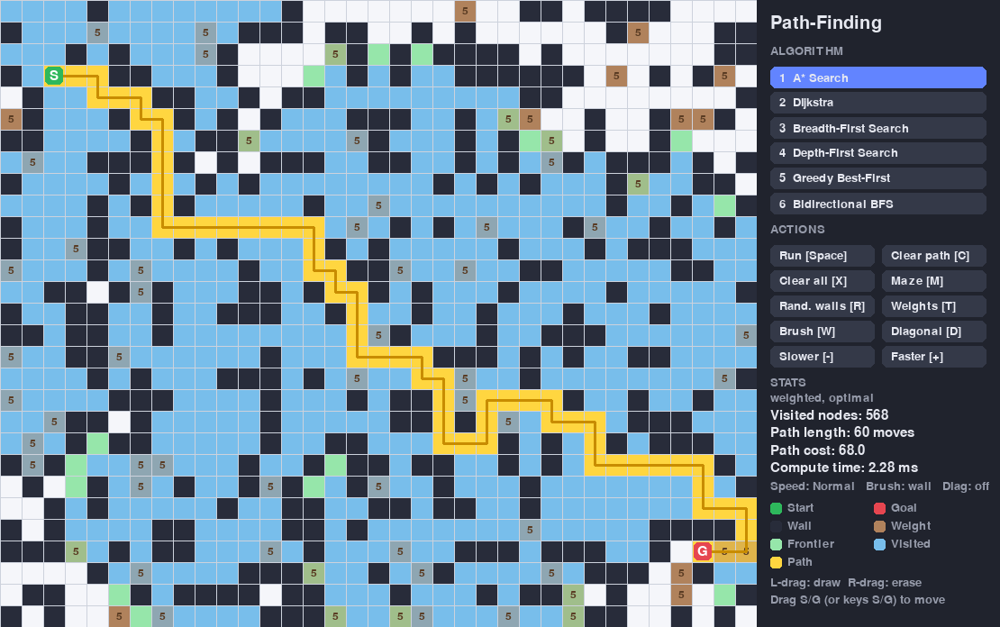

# Path-Finding Visualizer

An interactive 2D grid visualizer for classic path-finding algorithms, built with
[Pygame](https://www.pygame.org/). Draw walls, drop weighted "mud" cells, generate
mazes, drag the start and goal around and watch each algorithm explore the grid
step by step.



## Features

- **Six algorithms**, animated step by step (frontier, visited cells, final path):

  | # | Algorithm | Uses weights | Optimal path |
  |---|-----------|:---:|:---:|
  | 1 | A\* Search (Manhattan heuristic, octile with diagonals) | ✅ | ✅ |
  | 2 | Dijkstra | ✅ | ✅ |
  | 3 | Breadth-First Search | ❌ | ✅ (fewest moves) |
  | 4 | Depth-First Search | ❌ | ❌ |
  | 5 | Greedy Best-First Search | ✅ | ❌ |
  | 6 | Bidirectional BFS | ❌ | ✅ (fewest moves) |

- **Editable grid**: draw and erase walls with the mouse (fast drags are interpolated, so lines have no gaps).
- **Weighted cells** (cost 5) to show how Dijkstra/A\* route around expensive terrain.
- **Maze generator** (recursive backtracker), **random walls** and **random weights**.
- **Drag start/goal** anywhere. After a run has finished, every edit **re-solves instantly**.
- **Diagonal movement** toggle (no corner cutting through walls).
- **Adjustable animation speed**.
- **Stats panel**: visited nodes, path length, path cost and compute time.
- Algorithms are **pure generators**, completely separate from rendering, and covered by tests.

## Installation

Requires Python 3.10+.

```bash
git clone https://github.com/CommanderVibeCody/path-finding.git
cd path-finding
python -m venv .venv
source .venv/bin/activate        # Windows: .venv\Scripts\activate
pip install -r requirements.txt
```

## Running

```bash
python main.py
```

## Controls

| Input | Action |
|-------|--------|
| Left click / drag | Draw with the current brush (wall or weight) |
| Right click / drag | Erase walls and weights |
| Drag **S** / **G** | Move the start / goal node |
| `S` / `G` | Place start / goal at the mouse cursor |
| `1` – `6` | Select algorithm |
| `Space` / `Enter` | Run the selected algorithm (animated) |
| `C` | Clear the search (visited cells and path) |
| `X` | Clear all walls and weights |
| `M` | Generate a maze (recursive backtracker) |
| `R` | Generate random walls |
| `T` | Sprinkle random weighted cells |
| `W` | Toggle brush between wall and weight |
| `D` | Toggle diagonal movement |
| `+` / `-` | Faster / slower animation |
| `Esc` | Quit |

Everything is also available through the buttons in the side panel.

## Project structure

```
path-finding/
├── main.py                      # entry point
├── pathfinding/
│   ├── app.py                   # Pygame app: input, animation, drawing
│   ├── ui.py                    # colours, buttons, panel helpers
│   ├── grid.py                  # pure grid model (walls, weights, neighbours)
│   ├── maze.py                  # maze / random wall / weight generators
│   └── algorithms/
│       ├── base.py              # Step events, run(), heuristics
│       ├── astar.py
│       ├── bfs.py
│       ├── bidirectional.py
│       ├── dfs.py
│       ├── dijkstra.py
│       └── greedy.py
├── tests/                       # pytest suite (algorithms + headless app smoke tests)
├── tools/make_screenshot.py     # renders docs/screenshot.png headlessly
└── docs/screenshot.png
```

### How the algorithms work with the UI

Each algorithm is a generator `algorithm(grid, start, goal, diagonal=False)` that
yields `Step` events:

- `Step("frontier", node)` – a node was added to the open set,
- `Step("visit", node)` – a node was expanded,
- `Step("done", path=[...] or None)` – always the last event.

The app consumes a few steps per frame to animate the search, while
`pathfinding.algorithms.run()` runs an algorithm to completion and returns a
`SearchResult` (path, visited count, cost, time). That makes it trivial to use
the algorithms on their own:

```python
from pathfinding.grid import Grid
from pathfinding.algorithms import astar, run

grid = Grid.from_strings([
    "S..#....",
    ".#.#.##.",
    ".#...#.G",
])
result = run(astar, grid)
print(result.path, result.length, result.visited)
```

## Tests

```bash
pip install -r requirements-dev.txt
pytest
```

The suite checks that every algorithm finds valid paths, reports "no path" when
the goal is walled off, that BFS / Bidirectional BFS / Dijkstra / A\* return
shortest paths (cross-checked on hundreds of random grids, with and without
diagonals and weights), and runs the Pygame app headlessly
(`SDL_VIDEODRIVER=dummy`) to animate every algorithm and simulate mouse/keyboard input.

To regenerate the screenshot:

```bash
python tools/make_screenshot.py
```

## License

[MIT](LICENSE)
